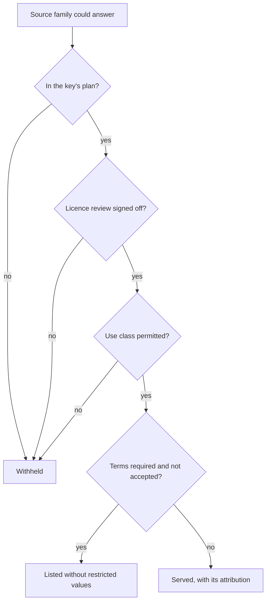

# Attribution and licence rules

The data the API serves comes from many publishers, each under its own
licence. Their terms decide what the API may return and to whom, and they
bind **you** when you display or pass on the data. The normative rules are on
the wiki page
[Spec: Data Licensing and Attribution](https://github.com/mavrovde/viafrei-api/wiki/Spec-Data-Licensing-and-Attribution).

## What every answer carries

Every data answer names each source family that contributed, in
`meta.attribution`, one entry per family:

| Member | Meaning |
|---|---|
| `family` | the source family's stable id |
| `domain` | the domain it answers for (`energy`, `parking`, `places`, …) |
| `publisher` | the publisher, as its licence asks to be named |
| `text` | the attribution notice you must show |
| `licence`, `licenceUrl` | the licence's name and canonical URL |
| `shareAlike`, `shareAlikeOffer` | share-alike data, and where the derived database is offered under the same licence |
| `termsUrl` | terms you must follow or accept, when any |

`meta.notes.condition` and `meta.notes.purpose` hold the conditions and
purposes the licences attach, **verbatim and untranslated**. They are legal
conditions, not captions.

An illustrative entry (the values are fictional):

```json
{
  "family": "src-alpha-energy",
  "domain": "energy",
  "publisher": "Example Data Office",
  "text": "Data: Example Data Office, Example Licence 1.0",
  "licence": "Example Licence 1.0",
  "licenceUrl": "https://licences.example/1.0",
  "shareAlike": false,
  "shareAlikeOffer": null,
  "termsUrl": null
}
```

Each operation also states its attribution rule in the OpenAPI document
(`x-attribution`), shown on the [endpoints](endpoints.html) page.

## Your obligations as a client

1. **Show the attribution with the data.** Wherever you display data from an
   answer, show the `text` of every `meta.attribution` entry that
   contributed to what you display, in a place your users can see.
2. **Pass the notes on.** Show every `meta.notes.condition` and
   `meta.notes.purpose` text with the data, unchanged. You may add a
   translation beside a note, never in place of it.
3. **Respect the purpose.** Data whose note restricts its purpose (for
   example "for consumer information only") may be used for that purpose
   only. Your key's plan names your use class; the API serves such data only
   to plans whose use class the terms permit.
4. **Accept terms before use.** Some families answer only after your key has
   accepted their terms. Until then, their items are listed without the
   restricted values (`termsRequired`), or the answer is refused with
   `403 terms-not-accepted`.
5. **Share alike.** When an entry has `shareAlike: true`, a database you
   publish that is derived from that data must be offered under the same
   licence. The obligation passes to you with the data; `shareAlikeOffer`
   shows where our own derived database is offered.
6. **Do not cache beyond the terms.** Follow `Cache-Control`, and keep data
   no longer than the terms behind its attribution allow.
7. **Do not strip.** Attribution, notes and the share-alike flag are part of
   the answer. No option of the API removes them, and your application must
   not remove them before display either.

## When a family is withheld

The licence gate serves a family only when your key's plan includes it, its
licence review is signed off, your use class is permitted and any required
terms are accepted.



Text description: the gate asks four questions of every source family that
could answer, in order. If the family is not in your key's plan, its licence
review is not signed off, or your use class is not permitted, the family is
withheld. Otherwise, if its terms must be accepted and your key has not
accepted them, its items are listed without the restricted values. In every
other case the family is served, with its attribution. A family that could have answered but was withheld is
named by the warning `partial` in `meta.warnings`; when no family may answer,
the request is refused with `403 source-not-permitted` or
`403 terms-not-accepted` ([error codes](errors.md)). `GET /v1/key` lists the
families your key may receive.

## Terms of use

The API's terms of use require you to pass attribution and notes on to your
users wherever you display the data. They are linked from the OpenAPI
document (`info.license`) and will be versioned and published with the first
public release.
